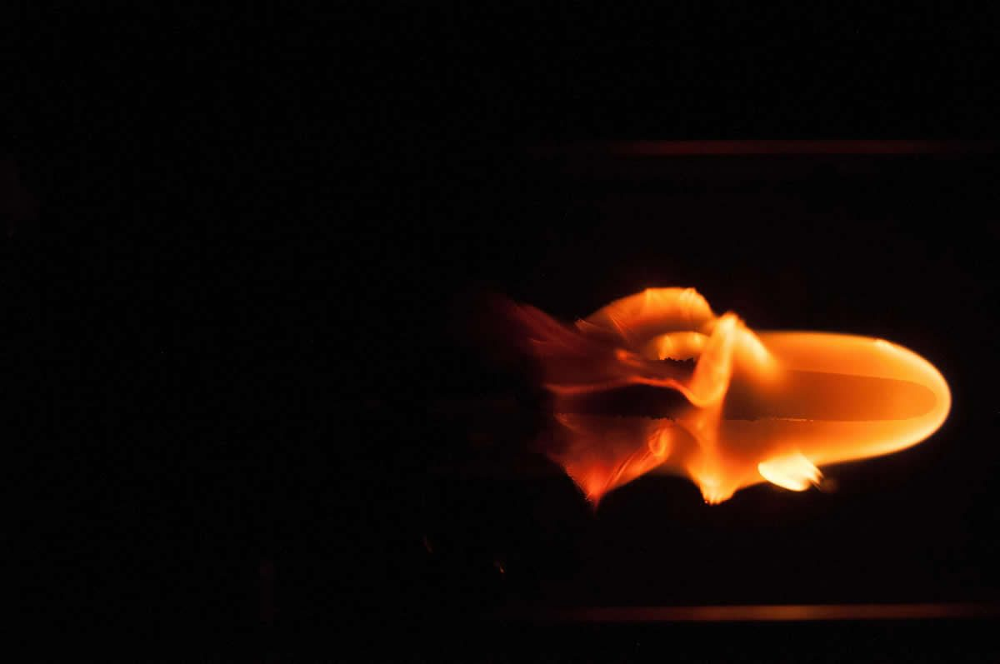
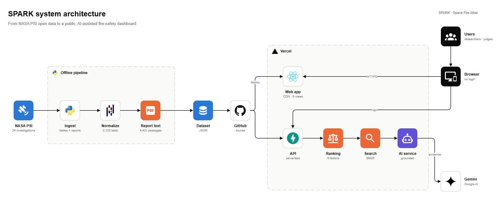
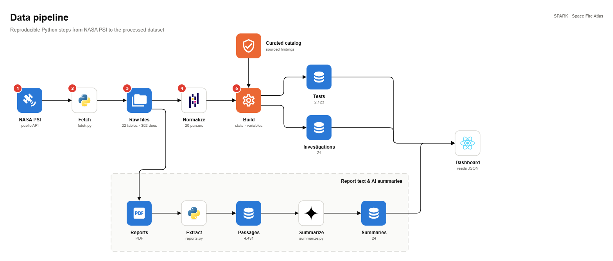
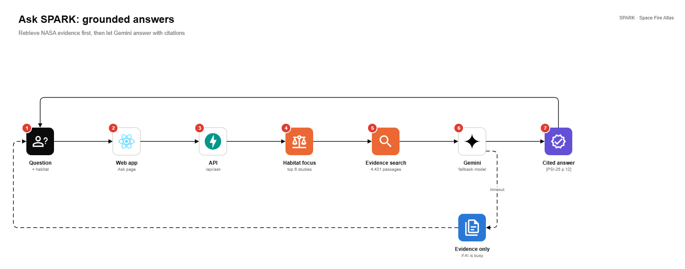
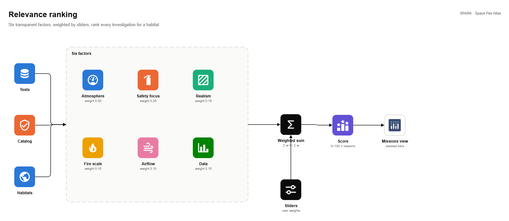

<div align="center">



# SPARK · Space Fire Atlas

**AI-assisted fire-safety insights for crewed space exploration, built on NASA microgravity combustion data.**

[**Live dashboard → spark-pi-liart.vercel.app**](https://spark-pi-liart.vercel.app) &nbsp;·&nbsp; NASA Space Apps Challenge 2026

</div>

---

## Why SPARK

Fire behaves differently in microgravity: with no buoyancy, flames become spheres, spread upstream into airflow and can survive at lower oxygen than on Earth. NASA has flown two decades of combustion experiments on the ISS and Cygnus, and the results sit in the [Physical Sciences Informatics (PSI)](https://psi.nasa.gov/physci/repo/search?q=combustion) repository. They are hard to find, compare and interpret.

SPARK **summarizes, ranks and interprets** those investigations for the habitats humans are about to build: spacecraft, space stations, Moon and Mars bases, and pressurized rovers.

## What it does

| View | What you get |
|---|---|
| **Missions** | Pick a habitat (ISS, deep-space spacecraft, Moon base, rover, Mars base, spacesuit). All 24 investigations are ranked with a transparent six-factor score you can re-weight, plus a chart showing what drives each score. |
| **Test Conditions** | Every PSI test plotted by oxygen and pressure against habitat design ranges, a density heatmap, an airflow chart and a FLEX suppression map. Empty habitat zones are the research gaps. |
| **Investigations** | Explorer with filters (pillar, platform, **hardware family**: ACME/CIR, MDCA/CIR, MSG flow duct, Cygnus, smoke instruments) and a page per study: AI summary, sourced key findings, charts of its own tests, what varied and what was held constant, sensors, DOI and publications. |
| **Data export** | **CSV and JSON downloads** of the normalized tests, per investigation or all 2,123 at once, with a data dictionary, for predictive flammability modeling. |
| **Compare** | Two to four investigations side by side with oxygen and pressure ranges, an attribute table and an AI-written comparison. |
| **Ask SPARK** | Plain-language questions answered from PSI evidence with clickable citations, e.g. `[PSI-25 p.12]`. |
| **Insights** | Lessons from Apollo 1, Apollo 13, Mir and Artemis II; myths microgravity research overturned; **next-generation equipment** (detectors, suppression, extinguishers, material screening, ventilation controls, fire models) linked to the evidence; data gaps for the Moon and Mars; Earth spinoffs. |

**Scope:** fires in crewed habitats. Rocket engine and propellant fires are outside the PSI data and this project.

## Key findings surfaced from the data

- **No PSI test was run inside a Moon-base atmosphere** (30–34 % O₂, 8.2–10.2 psi). The nearest are FLEX droplet tests at 34 % O₂ and ~10.4 psi.
- **The highest oxygen any solid material was burned at is 22.2 %** (BASS-II), far below planned lunar-habitat levels.
- Materials can burn at **lower oxygen in microgravity than on Earth**, so NASA's upward-burning screening test is not conservative (BASS, Researcher's Guide p. 31).
- Inert-gas suppressants offer **less safety margin in space** because the limiting oxygen index is lower (FLEX, Researcher's Guide p. 12).
- Spacecraft smoke detectors should target **pre-fire pyrolysis particles**, not soot (SAME / SAME-R).

## Architecture



An offline **Python pipeline** turns NASA PSI data into a curated JSON dataset. **Vercel** serves the React dashboard from a CDN and runs a **FastAPI** serverless API that ranks evidence, searches report text and asks **Google Gemini** for cited answers.

### Data pipeline



1. **Fetch** metadata, 22 experimental tables and 352 reports from the public PSI API.
2. **Normalize** every table into one schema with 20 small parsers: unit conversion (mmHg and bar to atm) and fixes for source quirks such as `"LOW O2"`, `"3400%"` and negative airflow readings.
3. **Build** the dataset by merging PSI records with a hand-curated catalog in which every finding cites its source. Outputs: 2,123 tests and 24 investigations.
4. **Extract** 4,431 passages from the final reports and **pre-generate** 24 AI summaries, so the site works even if the AI is unavailable.

### Ask SPARK: grounded answers



The AI never answers from memory alone. SPARK first focuses on the investigations most relevant to the chosen habitat and retrieves matching report passages (BM25 search). Gemini then answers using only that evidence, with citations. If every model is busy, the user still receives the evidence.

### Relevance ranking



`score = Σ wᵢ · fᵢ ÷ Σ wᵢ`. Every factor is between 0 and 1:

| Factor | Default weight | Measures |
|---|---|---|
| Atmosphere match | 0.30 | How close tested O₂ and pressure come to the habitat's design range |
| Fire-safety focus | 0.25 | Overlap with the habitat's prevention / detection / suppression needs |
| Material realism | 0.15 | Real cabin materials score above idealized gas flames |
| Fire scale | 0.10 | Large fires (Saffire) score above small samples |
| Airflow match | 0.10 | Share of tests at cabin ventilation speeds |
| Data available | 0.10 | Amount of test data published in PSI |

Results flag a **caution** when a highly relevant study was never tested at the habitat's oxygen level.

## NASA data used

All 24 investigations in the PSI **Combustion Science** research area:

| Group | Investigations |
|---|---|
| Solid materials | BASS (PSI-26), BASS-II (PSI-25) |
| Large-scale spacecraft fire | Saffire-I/II/III (PSI-98, 99, 100) |
| Smoke and detection | SAME (PSI-102), SAME-R (PSI-101), DAFT (PSI-47) |
| Liquid droplets | FLEX (PSI-69), FLEX-2 (PSI-68), CFI (PSI-39) |
| Gaseous flames | ACME CFI-G (PSI-159), Flame Design (PSI-10), BRE (PSI-20), CLD Flame (PSI-21), E-FIELD Flames (PSI-22), s-Flame (PSI-23), SPICE (PSI-107), SLICE (PSI-106) |
| Modeling (ground) | PSI-60, PSI-62, PSI-115, PSI-117, PSI-142 |

Also used: NASA Glenn combustion fact sheets; *A Researcher's Guide to ISS Combustion Science* (NP-2015-10-034-JSC); NASA accounts of Apollo 1, Apollo 13 and the 1997 Mir fire; and NASA Spinoff articles on firefighter air tanks, fire detectors and protective gear. Each investigation page in SPARK links to its PSI record and DOI.

## Tech stack

| Layer | Tools |
|---|---|
| Data pipeline | Python, pandas, pypdf, httpx |
| API | FastAPI (Python), BM25 search, Google Gemini API |
| Frontend | React, TypeScript, Vite, Tailwind CSS, Plotly |
| Hosting | Vercel (static CDN + Python serverless function) |

## Run locally

Requirements: Python 3.11+, Node 20+, and a free Gemini API key from [Google AI Studio](https://aistudio.google.com).

```bash
# 1. Backend dependencies and API key
pip install -r backend/requirements.txt
echo "GEMINI_API=your-key" > .env

# 2. (Optional) rebuild the dataset from NASA PSI. The processed data is already in data/processed
cd backend
python -m spark.pipeline.fetch metadata
python -m spark.pipeline.fetch docs
python -m spark.pipeline.build
python -m spark.pipeline.reports
python -m spark.pipeline.summarize

# 3. Start the API (port 8000)
uvicorn spark.api.main:app --reload --port 8000

# 4. In another terminal, start the web app (port 5173, proxies /api to 8000)
npm --prefix frontend install
npm --prefix frontend run dev
```

## Project structure

```
backend/spark/
  psi/        client for the public NASA PSI API
  pipeline/   fetch, table normalizers, build, report extraction, AI summaries
  core/       ranking engine, BM25 search, data store
  ai/         Gemini client (model fallback), prompts, grounded Q&A
  api/        FastAPI routes
frontend/src/ React pages, chart components, design system
data/
  raw/psi/    PSI records and experimental tables (CC0)
  curated/    hand-checked catalog, habitats, insights (every item sourced)
  processed/  dataset served by the API
api/index.py  Vercel serverless entry point
docs/architecture/  architecture diagrams
```

## Use of AI

- **In the product:** Google Gemini (`gemini-3-flash-preview`, falling back to `gemini-3.1-flash-lite`) writes the 24 investigation summaries, the Ask SPARK answers and the Compare narratives, strictly from retrieved PSI evidence. All AI output is labeled "AI" in the interface, with its sources shown.
- **In development:** the code, data pipeline and documentation were developed with the help of an AI coding assistant (Claude Code). Data values were checked against the raw NASA tables.
- No NASA logos or mission insignia are used or generated.

## Credits and license

Data: NASA Physical Sciences Informatics, CC0 1.0. Please cite each investigation by its DOI, shown on its SPARK page. Images: NASA PSI representative images (public domain). Logos in the architecture diagrams belong to their respective projects.

SPARK is an independent NASA Space Apps Challenge 2026 project and is not endorsed by NASA.
